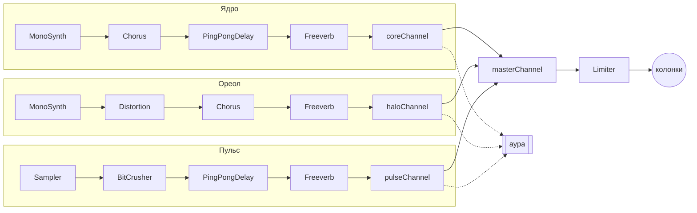

# Аура

Веб-синтезатор, который рисует ауру звуком.

- Сайт: https://dashulyamorozova07-blip.github.io/Aura-synth/
- Презентация: https://hsedesign.ru/project/801758d4d7584e6fb4c04478eb1060ac
- Скринкаст сета: [ссылка на Kinescope]

## Концепция

В центре экрана светящийся шар, аура: белая серединка, розовое тело, тёплый жёлтый ореол по краю и тонкие кольца вокруг. Пока тишина, шар маленький и бледный. Когда начинаешь играть, он растёт, разгорается и мягко мнётся: чем больше голосов звучит и чем они громче, тем больше энергии. Удары барабанов заставляют его вздрагивать, а кольца расходятся. Выключаешь голоса, и аура гаснет.

Каждый ползунок голоса меняет и звук, и ауру.

## Музыкальное высказывание: «Из холода в тепло»

Иногда человек будто замерзает внутри. Ничего не чувствует и закрывается от других. Сет о том, как это состояние постепенно проходит и человек снова открывается.

- **Звук.** Сначала звучит одна тихая мелодия в миноре. Потом вступают другие голоса, темп растёт, и музыка переходит в мажор.
- **Аура.** Сначала она бледная и холодная. К концу теплеет и разгорается вместе с музыкой.

| Этап | Что я делаю | Что видно |
| --- | --- | --- |
| 1. Оцепенение | нажимаю «Играть»: звучит одно Ядро, синус, холод, темп 80 | маленький бледный шар на ледяном голубом фоне |
| 2. Первый вдох | включаю Ореол, у Ядра делаю меньше зала | шар растёт, фон становится лиловым |
| 3. Оттепель | нажимаю «тепло», у Ядра треугольник и хорус, включаю Пульс, темп 96 | фон розовеет, шар начинает биться в ритм |
| 4. Открытость | все узоры на II, у Ореола пила, темп 104 | самый большой и яркий шар, коралловый фон |
| 5. Послесвечение | узоры на I, выключаю Пульс и Ядро, у Ореола синус и больше зала | мягкий розовый шар, в холод он уже не возвращается |

Синтезатор открывается сразу в начале сета: холод, темп 80, звучит только Ядро, Ореол и Пульс выключены.

## Из чего состоит инструмент

| Голос | Роль | Источник звука | Цепочка эффектов |
| --- | --- | --- | --- |
| **Ядро** | синт 1, высокая мелодия | `Tone.PolySynth` из `Tone.MonoSynth`, 4 формы волны | хорус → эхо → зал |
| **Ореол** | синт 2, бас и подклад | `Tone.PolySynth` из `Tone.MonoSynth`, 4 формы волны | искажение → хорус → зал |
| **Пульс** | барабаны | `Tone.Sampler`, сэмплы Roland TR‑909 | крошка → эхо → зал |

Эффекты: Chorus (хорус), PingPongDelay (эхо), Freeverb (зал), Distortion (искажение), BitCrusher (крошка).

У Ядра и Ореола внутри синтезатора есть фильтр. Он срезает резкие верхние частоты, поэтому даже квадрат и пила звучат мягко, а не жужжат.

### Каждая форма волны это эмоция

| Волна | Эмоция | Как звучит |
| --- | --- | --- |
| синус | покой | чистый звон |
| треугольник | тепло | мягкий и светлый звук |
| квадрат | меланхолия | глухо, как кларнет издалека |
| пила | гнев | плотно и напористо, но без визга |

Квадрат и пила звучат несколькими слегка расстроенными голосами сразу, поэтому они гуще. Настройки лежат в `coreWaveSettings` и `haloWaveSettings`.

## Каналы: куда идёт звук

У каждого голоса свой канал `Tone.Channel` с громкостью, панорамой и выключателем. Каналы сходятся в общий канал, а оттуда через лимитер в колонки. К каждому каналу подключён `Tone.Meter`: он измеряет громкость голоса, и по ней аура понимает, сколько в музыке энергии.



Все каналы стерео (`channelCount: 2`), поэтому панорама слышна в наушниках: голос можно увести в левое или правое ухо. Исходно Ядро чуть правее, Ореол чуть левее, Пульс по центру.

## Холод и тепло

В общем пульте есть переключатель «холод | тепло». Он меняет аккорды Ядра и Ореола и цвет ауры. Мелодии остаются теми же, меняются только ноты аккордов. Новые аккорды начинаются со следующего такта, поэтому музыка не обрывается.

| | Аккорды | Что с аурой |
| --- | --- | --- |
| **холод** | Am7 → Em7 → Dm7 → Am7, минор | фон и свечение вокруг шара синеют |
| **тепло** | Fmaj7 → Em7 → Dm7 → Cmaj7, мажор | фон розовеет |

Узоры записаны в тепле. В холоде каждая нота аккорда меняется на ноту холодного аккорда с тем же местом (основа, терция, квинта, септима).

## Как звук управляет аурой

Ауру рисует библиотека p5.js. Каждый голос отвечает за свою часть шара, а ползунки меняют его характер.

| Что делаешь | Что происходит с аурой | Почему так |
| --- | --- | --- |
| играет Ядро | белая серединка разгорается и вспыхивает на каждой ноте | Ядро это мелодия, сердце музыки |
| играет Ореол | шар растёт, светится сильнее и окрашивает фон | Ореол это бас, он «обнимает» всю музыку |
| удар Пульса | шар вздрагивает, кольца расходятся, фон чуть вспыхивает | удар как толчок энергии |
| холод или тепло | в холоде фон ледяной голубой, в тепле розовый | фон показывает настроение сета |
| энергия | чем больше энергии, тем теплее и розовее фон | музыка разгорается, и фон вместе с ней |
| резкий звук | искажение, крошка или пила уводят фон в глубокий фиолетовый, края экрана темнеют и краснеют | так выглядит гнев |
| фон | по фону медленно плывут размытые круги, их цвет меняется вместе с настроением | глубина и ощущение живого пространства вокруг ауры |
| выключаешь голос | его цвет уходит, шар бледнеет | нет голоса, нет его энергии |
| панорама | часть шара сдвигается влево или вправо: серединка за Ядром, тело за Ореолом, кольца за Пульсом | видно, где в пространстве звучит голос |
| форма волны | цвет: синус розовый, треугольник персиковый, квадрат лавандовый, пила коралловый | мягкий звук даёт мягкий цвет, резкий даёт яркий |
| зал | свечение вокруг шара шире и мягче | звук в большом зале тоже расплывается |
| эхо | колец становится больше | эхо повторяет звук, кольца повторяют шар |
| хорус | шар переливается и плывёт быстрее | хорус делает звук «качающимся» |
| искажение | шар сильнее мнётся | искажение «ломает» звук |
| крошка | больше зерна | крошка делает звук зернистым |
| громкость | больше громкости, больше энергии |  |

## Элементы интерфейса

| Компонент | Что делает |
| --- | --- |
| `TopBar` | общий пульт: темп, общая громкость, холод и тепло, запуск |
| `HarmonySwitch` | переключатель «холод \| тепло» |
| `PlayButton` | играть и остановить (также пробел) |
| `Voice` | стеклянная панель голоса: Ядро слева, Ореол справа, Пульс снизу |
| `ToggleButton` | включает и выключает голос |
| `PatternSwitch` | узор: спокойный или плотный |
| `WaveSwitch` | форма волны: синус, треугольник, квадрат, пила |
| `Fader` | ползунок: сила эффекта, громкость, панорама, темп |
| `AuraCanvas` | живая аура в центре (p5.js) |
| `Grain` | зерно поверх картинки |

Каждая панель голоса устроена одинаково сверху вниз: имя и вкл, узор, форма волны, цепочка эффектов (ползунки идут в том же порядке, в каком через них проходит звук), канал с громкостью и панорамой.

## Нейминг

Одно правило для кода и для макета: **сначала голос, потом тип узла, потом что это.**

- голоса: `core` (Ядро), `halo` (Ореол), `pulse` (Пульс), `master` (общий канал, куда сходятся все голоса)
- настройки: `coreSynthSettings`, `haloDistortionSettings`, `pulseFreeverbSettings`
- характер волн: `coreWaveSettings`, `haloWaveSettings`
- холод и тепло: `masterHarmonySettings`, `masterHarmonyChords`
- ноты: `coreSequenceI`, `coreSequenceII`, `pulseSequenceI`
- в HTML голос находится по `data-voice="core"`, эффект по `data-effect="reverb"`, холод и тепло по `data-harmony="cold"`
- компоненты интерфейса названы с большой буквы, как в Figma: `Voice`, `Fader`, `WaveSwitch`, `HarmonySwitch`

## Файлы

```
index.html          разметка: пульт и три панели голосов
css/reset.css       сброс стилей браузера
css/style.css       визуальный стиль
js/settings.js      настройки голосов, волн, эффектов и каналов
js/sequences.js     ноты: по два узора на голос и аккорды холода и тепла
js/audio.js         сборка звука: цепочки, каналы, узоры, холод и тепло
js/aura.js          живая аура на p5.js, которая слушает звук
js/interface.js     связь кнопок и фейдеров с голосами
samples/            5 сэмплов Roland TR‑909
favicon.svg         значок вкладки
.prettierrc         правила оформления кода (как в репозитории курса)
.gitignore          служебные файлы, которые не попадают в репозиторий
```

## Музыка

Гармония на 4 такта, у неё два настроения: холод (Am7 → Em7 → Dm7 → Am7) и тепло (Fmaj7 → Em7 → Dm7 → Cmaj7). Темп в начале сета 80, на пике 104.

- **Ядро.** Спокойно: арпеджио четвертями. Плотно: переливы восьмыми.
- **Ореол.** Спокойно: одна долгая нота на такт. Плотно: пульсирующий бас.
- **Пульс.** Спокойно: мягкий шаг бочки с римшотом. Плотно: полный бит с малым барабаном и хэтами.

## Как я использовала нейросеть

**Использованные нейросети:** Claude

**Для чего:** помощь с написанием и исправлением кода синтезатора, отрисовка элементов интерфейса и объяснение того, как устроены звук и инструменты разработки.

**Что делала я**

- выбрала идею ауры и собрала визуальные референсы с мягкими градиентами
- придумала, как выглядит аура: нарисовала макет шара (белая серединка, розовое тело, тёплое свечение и тонкие кольца)
- выбрала раскладку и задавала общий стиль: стекло, цвета, шрифт, круги на фоне
- проверяла, как звучит и выглядит инструмент, и искала ошибки в браузере
- придумала, как голоса связаны с частями ауры
- придумала тему сета «Из холода в тепло» как состояние человека, который оттаивает
- решила, что каждая форма волны звучит как эмоция, и подобрала звук для гнева

**Как использовалась нейросеть**

- **Код.** Написать код звука на Tone.js и анимации ауры на p5.js по моему описанию, а потом исправлять его по моим замечаниям.
- **Звук.** Сделать звук мягче и мелодичнее, добавить фильтр и характер каждой волне, сделать переключатель «холод | тепло».
- **Дизайн.** Нарисовать элементы интерфейса (значки форм волн и узоров) и перенести мой макет ауры в код.
- **Обучение.** Объяснить, как работают эффекты, каналы, формы волн и панорама.

**Примеры промптов**

- Сделай так, чтобы цвет и анимация фона менялись в зависимости от того, что играет. В центре должна быть аура как на моём макете: белая серединка, розовое тело, тёплое жёлтое свечение и тонкие белые кольца вокруг.
- Квадрат и пила звучат неприятно, а это же меланхолия или наоборот гнев.


**Процесс работы**

1. Сбор референсов и выбор концепции «Аура».
2. Макет ауры и выбор раскладки интерфейса.
3. Написание кода звука и анимации с помощью Claude по моему описанию.
4. Проверка в браузере и правки по моим замечаниям.
5. После предпросмотра: тема сета «Из холода в тепло», переключатель «холод | тепло», новый звук и более выразительный фон.
6. Публикация проекта на GitHub.
